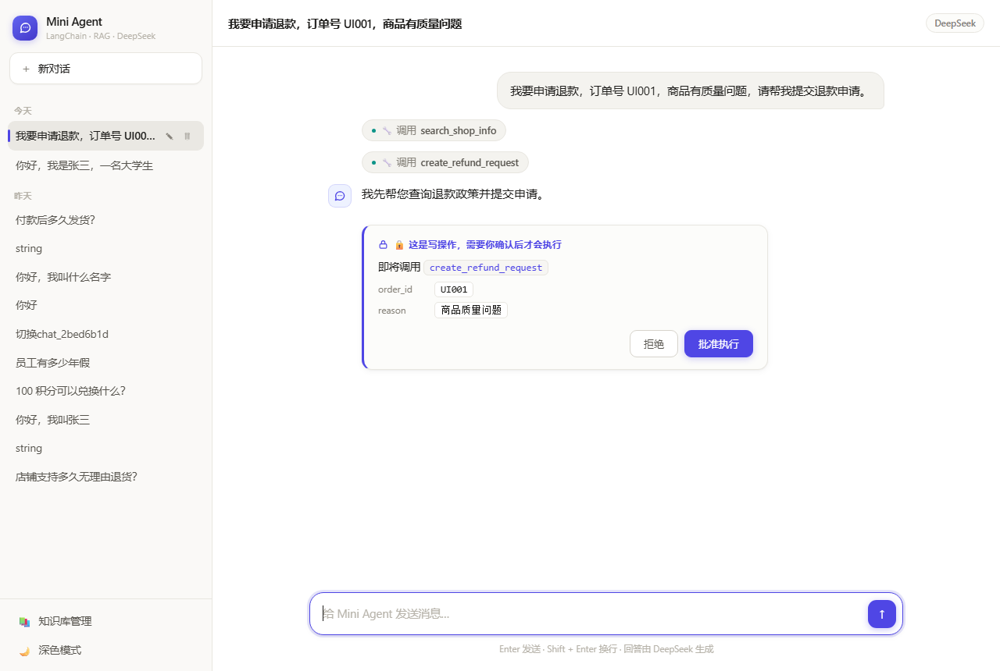
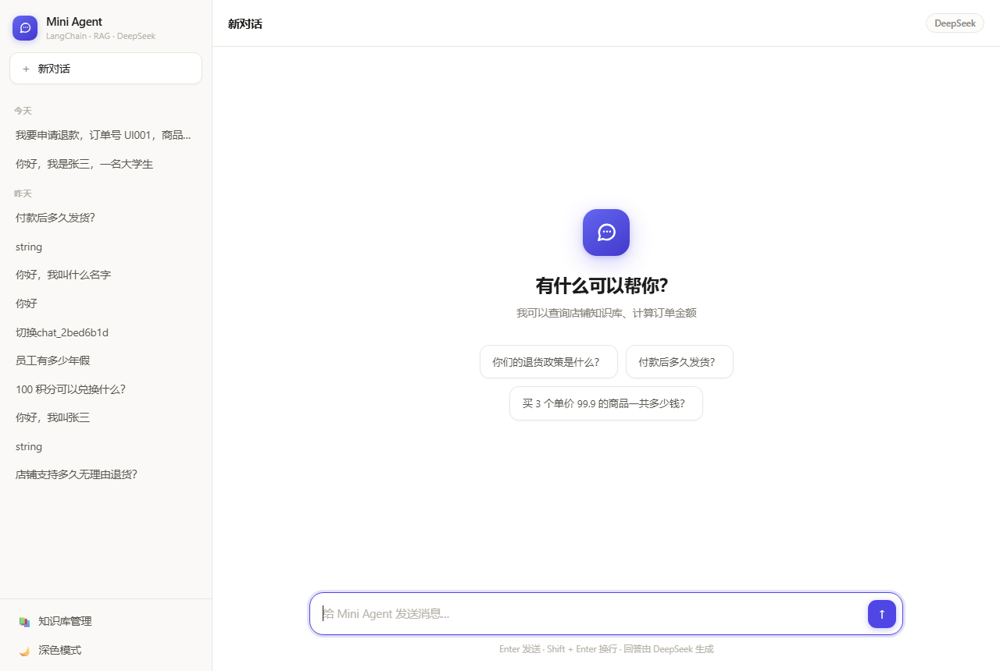
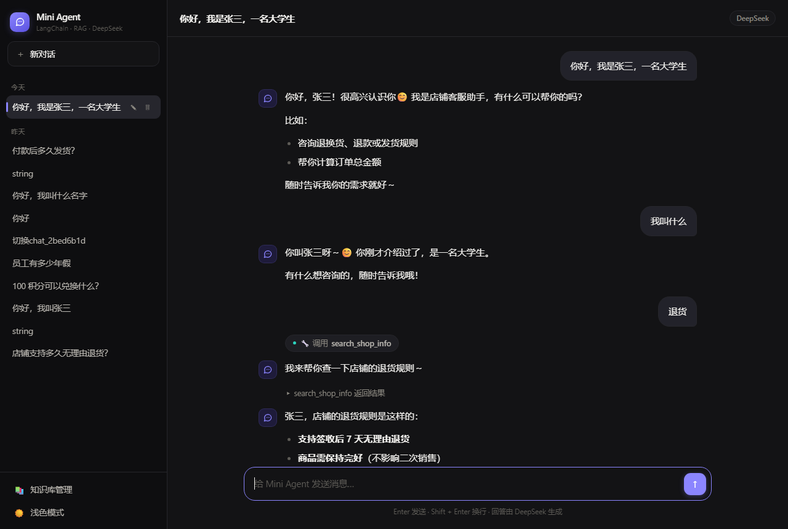
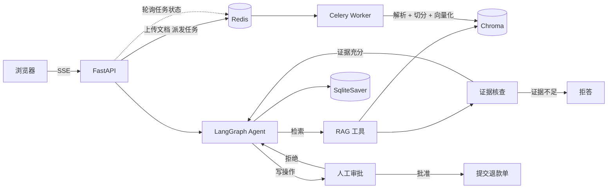

# 智能售后工单 Agent

面向售后退款场景的工单处理 Agent：**检索政策 → 核查证据是否充分 → 判断可退性 → 提交退款单（需人工审批）→ 幂等防重**。

不是"能回答问题的客服机器人"，而是能走完一条业务流程的系统：答案有对错，操作有后果。



<details>
<summary>更多截图（欢迎页 / 深色模式）</summary>

| 欢迎页 | 深色模式 |
|---|---|
|  |  |

</details>

---

## 技术栈

| 层 | 选型 |
|---|---|
| Agent | LangGraph 1.2（`create_agent` + `HumanInTheLoopMiddleware`） |
| 模型 | DeepSeek（OpenAI 兼容接口） |
| 检索 | Chroma + `bge-small-zh-v1.5`，多租户 `where` 前置过滤 |
| 持久化 | SQLite（会话 / 记忆 / 工单） |
| 服务 | FastAPI + SSE 流式 |
| 异步任务 | Celery 5.5 + Redis（broker + result backend） |
| 记忆 | LangGraph `SqliteSaver`（按 thread_id 隔离） |
| 前端 | 原生 HTML/CSS/JS，无构建步骤 |

---

## 核心能力

**1. 带证据核查的 RAG**
检索后先由 LLM 判断"证据是否足以回答"，不足则明确拒答，而不是硬编一个答案。检索结果带来源标注，支持追溯。

**2. 写操作人工审批**
退款申请这类有副作用的操作会通过 LangGraph `interrupt` 暂停，前端弹出确认卡片，用户批准后才真正执行；拒绝则把理由反馈给模型，模型改口。

**3. 三层幂等保护**
接口层用图状态守卫（无待审批直接 409），工具层查库判重（同一订单返回原单号），数据库层用部分唯一索引 `WHERE status='executed'` 兜住并发。前两层都是「读-判断-写」，只有数据库约束能真正防住竞态。

**4. 可量化的评测体系**
62 条人工标注测试集：**单轮 50 条**（简单 20 / 改写 15 / 多跳 5 / 近邻难负例 10）+ **多轮 12 条**（指代消解 / 信息补全 / 话题切换各 4 条），其中 10 条 hold-out。

多轮题靠 `history` 字段逐条回放，让 agent 真实响应每一轮，而不是把历史拼成一条消息——后者测不出 checkpointer 是否真的在累积状态。

**结果**：单轮 50/50、多轮 12/12（连跑 3 次 36/36），平均单题 2.04s。

**5. 文档索引异步化**
上传接口立刻返回 `task_id`，解析、切分、向量化在 Celery worker 里跑，前端轮询进度。任务只对瞬时错误重试，幂等键是内容哈希，重试不会产生第二份索引。

**6. 无 broker 也能跑**
Redis 不可用时自动降级为进程内后台线程。这不是妥协——它让项目在任何环境都能演示；生产必须用真 broker，进程内方案进程一挂任务就丢。

**7. 多租户权限过滤（检索前）**
文档带 `tenant` 元数据，检索时用 Chroma 的 `where` 只在「本租户 + 公共」子集里做 ANN。同一句问题，ACME 看到 99 元协议价、GLOBEX 看到 109 元、未带租户的只能看到标准价并明确拒答。

**8. 工单状态机 + 审计**
退款单从内存字典改为 SQLite 持久化，状态流转 `pending_approval → approved → executed`（或 `rejected` / `failed`）。非法迁移被拒绝，同一订单只能有一张 `executed` 工单——这条规则由**数据库部分唯一索引**保证，不靠代码判重。

**9. 渐进加载的 Skill 机制**
流程知识（退款五步流程、投诉升级判断、检索降级策略）不再塞进 system prompt，而是拆成 `skills/` 下的独立目录。模型先调 `list_skills` 看目录（名称 + 适用场景），判断相关才用 `load_skill` 加载正文。

实测：3 个技能的目录共 252 字，全量正文 2857 字，**压缩比 11.3 倍**。加一个技能只需加一个目录，不改代码、不动 prompt。

**10. 并发吞吐：从 1.00x 到 17.4x**
原来有一把全局锁包住整个 agent 调用，把系统完全串行化。压测实测（20 并发 / 单请求 0.8s）：

| | 改造前 | 改造后 |
|---|---|---|
| 总耗时 | 16.04s | **0.92s** |
| 吞吐 | 1.25 req/s | **21.79 req/s** |
| P50 延迟 | 8.83s | **0.90s** |
| 实际并行度 | 1.00x | **17.43x** |

改动：拆锁（LangGraph 图本身无状态，状态在 checkpointer 按 thread_id 隔离）、SQLite 开 WAL、修连接泄漏、用长连接钉住 `-wal`/`-shm`（并发首写会竞争创建这两个文件，实测 8 线程里 7 个报 readonly）。

---

## 架构



---

## 快速开始

### Docker（推荐）

```bash
# 1. 配置密钥
echo "DEEPSEEK_API_KEY=sk-xxxx" > .env

# 2. 指定模型缓存目录（宿主机已有 bge-small-zh-v1.5 的话）
export HF_CACHE_DIR=~/.cache/huggingface

# 3. 启动
docker compose up --build

# 4. 首次运行需要构建索引（有缓存可跳过）
docker compose exec app python rebuild_index.py
```

打开 http://localhost:8000

**构建说明**

首次构建约 13 分钟（要下载 torch 和全套依赖），之后改代码重建**只要几秒**——`Dockerfile` 用了 BuildKit 的 pip 缓存挂载，依赖层不会重复下载。

国内网络默认走阿里云镜像。海外环境可覆盖：

```bash
docker build \
  --build-arg PIP_INDEX=https://pypi.org/simple \
  --build-arg TORCH_FIND_LINKS=https://download.pytorch.org/whl/cpu \
  -t shop-agent:latest .
```

> ⚠️ **密钥注意**：容器只读 `.env` 文件，不会像本地那样被 shell 环境变量覆盖。
> 如果本地能跑但容器报 401，先确认 `.env` 里是有效密钥——
> `python-dotenv` 默认**不覆盖**已存在的环境变量，所以本地测试可能用的是 shell 里的值，掩盖了文件里的过期密钥。

### 本地运行

```bash
pip install torch --index-url https://download.pytorch.org/whl/cpu
pip install -r requirements.txt

echo "DEEPSEEK_API_KEY=sk-xxxx" > .env

python rebuild_index.py          # 首次运行
uvicorn api:app --port 8000
```

**可选：启动 Celery worker（需要 Redis）**

```bash
# 终端 2
celery -A celery_app.celery_app worker --loglevel=info --pool=solo
```

不启动 worker 也能用——Redis 不可用时索引任务会自动降级为进程内线程执行，
只是任务状态存在内存里，进程重启就丢。生产环境必须配真 broker。

### 跑测试

```bash
pytest                    # 114 个用例，约 26 秒，不调用大模型
pytest -m llm             # 需要真实模型的端到端测试
```

---

## 评测结果

22 篇知识库文档（含 2 篇租户专属）/ 62 条测试集（单轮 50 + 多轮 12），其中 10 条为 hold-out（只用于验收，不参与调参）。

| 指标 | 结果 |
|---|---|
| 检索 Hit@1 | **93.88%** |
| 检索 MRR@10 | **0.9660** |
| 检索 P50 / P95 | 14.2 ms / 15.7 ms |
| 证据核查准确率 | 100%（TP 9 / TN 8 / FP 0 / FN 0） |
| Agent 端到端任务成功率（单轮） | **50/50** |
| Agent 端到端任务成功率（多轮） | **12/12**（连跑 3 次 36/36） |
| 端到端平均耗时 | 2.41 s（多轮 2.04 s） |

> **一个评测方法上的坑**：多轮题第一次跑出 11/12，失败那条模型答的是「收货地址就**不能再修改**了」——
> 答案是对的，但关键词表里只有「不可修改」「不能修改」，判定器漏判。
>
> 这暴露了两件事：① 关键词判定会有**假阴性**，失败的用例必须人工复核，不能只看数字；
> ② LLM 措辞有随机性，**单次运行的数字不可信**。所以多轮结果是连跑 3 次统计的。
> 放宽词表后 3 次全过，但词表是按失败样本补的，严格说这 12 条已经不算完全干净的测试集了——
> 真要严谨应该另留一份多轮 hold-out。

复现：

```bash
python evaluate_rag.py            # 检索策略对比
python evaluate_answerability.py  # 证据核查二分类
python evaluate_agent.py          # 端到端任务成功率
python tune_rrf.py                # RRF 权重扫描（仅用非 hold-out）
```

---

## 关键设计决策

这一节记录"为什么这么做"，以及被数据否掉的方案。

### 1. 为什么用 LLM 核查证据，而不是距离阈值

直觉方案是"距离大于阈值就拒答"。实测正负例距离分布：

| | 距离范围 |
|---|---|
| 正例（有答案） | 0.4747 – **0.9279** |
| 负例（无答案） | **0.7725** – 1.1348 |

两者在 **0.7725 – 0.9279** 区间重叠，任何单一阈值都至少错判一条。所以必须引入语义判断层。

代价是每次 RAG 变成两次 LLM 调用（核查 + 回答），延迟翻倍。这是一个用延迟换准确率的自觉权衡，不是没想过优化。

### 2. 为什么放弃 BM25 混合召回

实现了向量 / BM25 / RRF 融合三种策略并做了对比：

| 向量:BM25 权重 | Recall@5 | Hit@1 | MRR@10 |
|---|---|---|---|
| **1.0 : 0.0** | 100% | **92.11%** | **0.9561** |
| 0.9 : 0.1 | 100% | 86.84% | 0.9189 |
| 0.5 : 0.5 | 100% | 86.84% | 0.9175 |

**任何非零 BM25 权重都会降低效果。** 原因是原理性的：

- 测试集大量是口语化改写（"我想买件跑步穿的裤子" vs 文档"运动长裤"），字面零重叠，关键词匹配无法命中；
- RRF 的 `1/(k+rank)` 在相邻名次间只差约 0.0002，哪怕 0.1 权重也足以翻转向量的头名；
- 向量已经 100% Recall@5，**没有补救空间** —— 混合召回的价值前提是"有一路会漏"。

结论：保留代码（换到含大量精确实体的语料时 BM25 有价值），默认走纯向量。这个负结果记录在 `retrieval.py` 的注释里。

### 3. 三层幂等，而不是只做一层

- **接口层**：`/chat/resume` 先检查图状态，无待审批直接 409 —— 挡住用户双击
- **工具层**：`create_refund_request` 先查库有无已执行的退款单 —— 挡住任何重放
- **数据库层**：`order_id` 上建**部分唯一索引** `WHERE status = 'executed'` —— 挡住并发

前两层都是"读-判断-写"，并发下存在竞态：两个请求同时查到"没有"，然后都去写。只有数据库约束能真正兜住。

用**部分**唯一索引而不是普通唯一索引，是因为被拒绝的申请可以有多条，同一订单只有成功退款才唯一。这条业务规则直接写进索引定义，比在代码里判断更可靠。

### 4. 测试分两层

- 用 `FakeAgent` 替换真实 Agent 测 SSE 协议和审批流程：**毫秒级、零成本、结果确定**
- 真实模型的端到端测试标记 `@pytest.mark.llm`，默认不跑

44 个用例 16 秒跑完。如果每个用例都真调模型，一次要几分钟还烧钱，没人会跑第二遍。

### 5. 启动耗时从 23 分钟降到 11 秒

`sentence-transformers` 加载模型时会向 huggingface.co 发大量 HEAD 请求校验文件。国内连不上，每次 10 秒超时 × 5 次重试 × 几十个文件 = 1378 秒。

模型早已缓存本地，这些校验纯属浪费。在 `rag.py` 的第三方导入**之前**设置 `HF_HUB_OFFLINE=1` 即可（该变量在模块导入时读取一次，写在导入之后无效）。

---

## 性能

`perf.py` 在关键路径埋点，`perf_report.py` 跑一批请求输出分阶段分布：

```bash
python perf_report.py 8 3      # 8 次检索 + 3 次完整对话
```

实测结果（单机，DeepSeek API）：

| 阶段 | P50 | P95 |
|---|---|---|
| 向量检索 | 11.0 ms | 13.8 ms |
| 证据核查（含一次 LLM 调用） | 707.4 ms | 937.6 ms |
| 首字延迟 TTFT | 1571.8 ms | 2396.3 ms |
| 整轮耗时 | 2991.1 ms | 3206.0 ms |

**瓶颈结论：**

- **向量检索只占 13.8ms，证据核查占 937.6ms，差 68 倍。** 慢在模型调用，不在向量库——所以优化向量库（换索引、调参、加缓存）几乎没用。
- **TTFT 占总耗时一半以上。** 因为首字之前必须先跑完工具调用（检索 + 核查），模型拿到证据才开始生成。这是"先核查再回答"的固有代价，不是流式没生效。
- **单轮平均 1.0 次工具调用。** 没有出现反复调用的情况，说明工具描述和 system prompt 的约束到位。

可观测接口：`GET /metrics`（JSON）、`GET /metrics/text`（表格）。

### 6. 索引异步化，但保留降级路径

上传一个几百页 PDF 要做：解码 → 解析 → 切分 → 逐块 embedding → 写库。同步做的话 HTTP 请求一直挂着，网关还可能超时断开。

所以拆成：**HTTP 只做校验和派发，立刻返回 `task_id`；解析和向量化交给 Celery worker；前端轮询状态。**

两个细节值得说：

- **只重试瞬时错误**。文件格式错误（`ValueError`）重试一百次也不会好，直接抛出；网络/IO 抖动才走 `self.retry`。
- **降级到进程内线程**。Redis 不可用时退化为 `threading.Thread` + 内存任务表。这不是为了偷懒，而是让项目在没有 broker 的机器上也能完整演示；代价是进程一挂任务就丢，所以生产必须用真 broker。

### 7. 权限过滤放在检索前

直觉做法是"先检索 top-k，再按权限筛掉"。但这样会有个隐蔽问题：**被筛掉的文档已经占用了 top-k 的名额**。用户可能只看到 1 条甚至 0 条结果，而库里明明有他能看的内容。

正确做法是把权限条件交给向量库（Chroma 的 `where`），只在可见子集里做 ANN：

```python
filter={"tenant": {"$in": [user_tenant, "public"]}}
```

代价是候选池变小，召回数量可能不足，所以 `k` 要适当放大。这一点在测试里专门守着（`test_tenant_does_not_starve_public_docs`）。

**还有个坑**：`where` 只匹配"字段存在且值符合"的文档，**没有 `tenant` 字段的存量数据会被静默排除**。所以上线前必须跑 `migrate_tenant.py` 补字段，否则用户会突然发现自己连商品价格都查不到——而且是静默失败，极难排查。

### 8. 工单状态机用数据库约束表达业务规则

退款单原本是内存字典 `{order_id: refund_id}`，三个硬伤：重启即丢、没有状态、没有审计。

改成 SQLite 表之后，状态流转写成显式的迁移表：

```
pending_approval → approved → executed
       ↘ rejected        ↘ failed
```

不在表里的迁移一律拒绝。这样"已执行的工单不能退回"这类规则由代码结构保证，而不是靠开发者记得判断。

审计能力是顺带得到的：`operator` / `decision` / `created_at` / `updated_at` 都在表里，`GET /tickets` 就能查"谁在什么时候批准了哪笔退款"。

---

## API

| 方法 | 路径 | 说明 |
|---|---|---|
| GET | `/` | 聊天界面 |
| GET | `/knowledge` | 知识库管理界面 |
| POST | `/sessions` | 新建会话 |
| GET | `/sessions` | 会话列表 |
| PATCH | `/sessions/{id}` | 重命名 |
| DELETE | `/sessions/{id}` | 删除（含对话记忆） |
| GET | `/sessions/{id}/messages` | 历史消息 + 待审批动作 |
| POST | `/chat/stream` | 流式对话（SSE） |
| POST | `/chat/resume` | 提交审批结果（SSE） |
| POST | `/knowledge/upload` | 上传文档（异步，返回 task_id） |
| GET | `/knowledge/tasks/{id}` | 查询索引任务状态 |
| GET | `/knowledge/documents` | 文档列表 |
| DELETE | `/knowledge/documents/{id}` | 删除文档 |
| GET | `/tickets` | 工单列表（审批审计记录） |
| GET | `/skills` | 技能清单与体积统计 |
| GET | `/health` | 存活探针 |
| GET | `/ready` | 就绪探针（校验向量库 / 工单库 / 会话库） |
| POST | `/rag/debug` | 检索调试（返回排名与距离） |

SSE 事件协议：

```
status → (tool | token)* → interrupt 或 done
```

`interrupt` 表示停在审批点，前端需弹出确认卡片并调用 `/chat/resume`。

---

## 项目结构

```
api.py                  FastAPI 应用、会话管理、SSE、审批接口
rag.py                  索引构建、文档增删、检索、证据格式化、多租户过滤
retrieval.py            四种检索策略（vector / bm25 / hybrid / rerank）
test_answerability.py   证据核查（verify_evidence）
celery_app.py           Celery 配置（broker / backend / 重试策略）
tasks.py                索引任务、任务派发、降级与状态查询
tickets.py              工单状态机与持久化（部分唯一索引保证幂等）
skills/                 Skill 机制（registry.py + 三个技能目录）
db.py                   SQLite 连接工厂（WAL / busy_timeout / 连接不泄漏）
migrate_tenant.py       给存量向量块补 tenant 元数据
perf.py                 分阶段耗时采样（P50/P95）
perf_report.py          性能报告与瓶颈判断
eval_dataset.py         62 条评测集（单轮 50 + 多轮 12，单一数据源）
evaluate_rag.py         检索策略对比
evaluate_answerability.py  证据核查二分类
evaluate_agent.py       端到端任务成功率
tune_rrf.py             RRF 权重扫描
rebuild_index.py        保留上传文档的重建索引
seed_distractors.py     生成干扰文档
download_reranker.py    下载 Reranker 模型
index.html              聊天界面（浅色 / 深色，支持 ?theme= 与 ?new=1）
knowledge.html          知识库管理界面
knowledge/              22 篇语料（20 篇公共 + 2 篇租户专属）
docs/screenshots/       README 用的界面截图

tests/                  pytest 用例（114 个，26 秒）
  test_sessions.py        会话 CRUD 与会话隔离
  test_knowledge.py       异步索引、去重、超限
  test_retrieval.py       检索策略与索引完整性
  test_chat_sse.py        SSE 协议与审批流程（FakeAgent）
  test_tenant.py          多租户权限过滤
  test_tickets.py         工单状态机
  test_skills.py          Skill 扫描、解析、渐进加载
  test_concurrency.py     连接层 + 串行化回归
  test_eval_dataset.py    评测集分组 + 多轮回放逻辑
  test_hitl_http.py       真实模型端到端（标记 llm，默认跳过）

conftest.py             pytest 夹具（含 FakeAgent、工单库隔离）
pytest.ini              pytest 配置（默认跳过 llm 标记）
scripts/probe_hitl.py   验证 interrupt 机制的最小实验
scripts/bench_concurrency.py  并发压测（对比锁的影响）
Dockerfile / docker-compose.yml / requirements.txt
```

---

## 已知限制

- **知识库规模小**（20 篇 / 20 个 chunk）。`Recall@5` 在此规模下必然接近 100%，真正有区分度的是 `Hit@1` 和 `MRR@10`。要让它有意义需要 100+ chunk。
- **Agent 端到端 100% 是天花板问题**。题目与文档边界清晰，难负例的"缺失信息"都是文档里完全没出现过的概念，拒答偏容易。想做出区分度需要"边界可答性"题或"文档冲突"题。
- **检索仍是纯向量**。BM25 融合已验证无收益，Reranker 因网络原因未接入（`download_reranker.py` 可补齐）。
- **写操作仍是串行**。全局锁已拆除，读和 LLM 调用可以并发；但 SQLite 只允许一个写者，高并发写入仍需换 PostgreSQL。这是单机 SQLite 的固有限制，不是实现问题。
- **写操作为模拟实现**。`create_refund_request` 存在内存字典里，重启即丢；真实项目应落库并加唯一索引。
