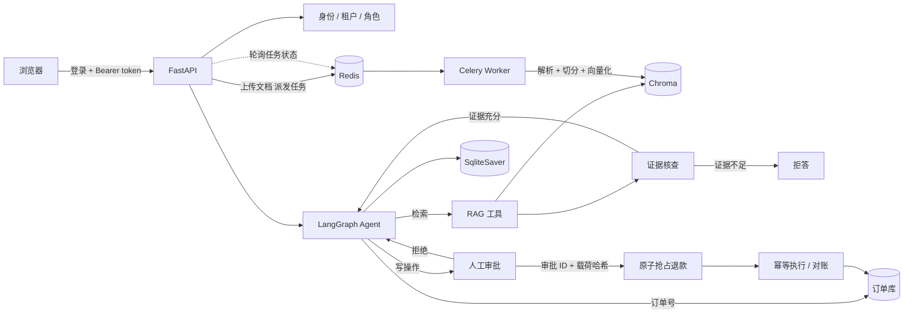

# 智能售后工单 Agent

面向售后退款场景的工单处理 Agent：**服务端鉴权 → 订单归属核验 → 检索政策 → 核查证据 → 判断可退性 → 人工审批 → 幂等执行 → 失败恢复**。

不是"能回答问题的客服机器人"，而是尝试把 Agent 的建议变成受权限、审批和数据库约束控制的可执行动作。租户、用户与角色来自服务端签发的短期 Bearer token，不接受客户端在聊天请求里自行声明租户。

安全边界、已实现的防护和生产缺口见 [SECURITY.md](SECURITY.md)。


<details>
<summary>更多截图（欢迎页 / 深色模式）</summary>

| 欢迎页 | 深色模式 |
|---|---|
|  |  |

</details>

---

## 技术栈

| 层 | 选型 |
|---|---|
| Agent | LangGraph 1.2（`create_agent` + `HumanInTheLoopMiddleware`） |
| 模型 | DeepSeek（OpenAI 兼容接口） |
| 检索 | Chroma + `bge-small-zh-v1.5`，多租户 `where` 前置过滤 |
| 鉴权 | PBKDF2 密码哈希 + HMAC-SHA256 Bearer token |
| 持久化 | SQLite（用户 / 会话 / 记忆 / 订单 / 工单 / 退款执行） |
| 服务 | FastAPI + SSE 流式 |
| 异步任务 | Celery 5.5 + Redis（broker + result backend） |
| 记忆 | LangGraph `SqliteSaver`（按 thread_id 隔离） |
| 前端 | 原生 HTML/CSS/JS，无构建步骤 |

---

## 核心能力

**1. 带证据核查的 RAG**
检索后先由 LLM 判断"证据是否足以回答"，不足则明确拒答，而不是硬编一个答案。检索结果带来源标注，支持追溯。

**2. 风险分级审批**
退款申请会通过 LangGraph `interrupt` 暂停。服务端在展示卡片前创建 `pending_approval` 工单，把登录用户、租户、会话、订单、金额和退款原因哈希绑定在一起。恢复时必须提交同一 `approval_id`，只改订单号或原因都无法复用审批。

工单上还会记录**风险分级**（`risk_tier` / `risk_reasons` / `rule_version`）：

| 档位 | 判定 | 谁能批 |
|---|---|---|
| `low` | 金额、时限、频次都在正常范围 | 客户本人确认 |
| `high` | 大额 / 距退款截止不足 24 小时 / 24 小时内已退 ≥2 笔 | `approver` 角色，且**不能是发起人** |

高风险单客户自己点确认会拿到 403，必须由同租户的另一个审批人从 `/tickets/{id}/decision` 处理；批准后直接执行，不等客户下次说话（主管不在那个会话里，图不会恢复）。

演示账号里有独立的审批人 `acme-approver`（角色只有 `approver`）——四眼原则要求
审批人和发起人不是同一个人，所以不能用 `acme-manager` 一个人演两个角色。
登录后侧边栏会出现「审批队列」，列出本租户待审批的高风险单，带风险原因、
规则版本和金额；发起人看自己的单时批准按钮是禁用的。

**3. 退款执行闭环**
状态流转为 `pending_approval → approved → executing → executed`，失败进入 `failed`。`approved → executing` 使用带源状态条件的原子 UPDATE；下游退款以工单 ID 作为幂等键，并有数据库唯一约束。即使下游成功、工单更新前进程退出，重试也会拿回同一个退款单号。

**4. 分层评测与安全回归**
92 条人工标注的开发回归集：**单轮 80 条** + **多轮 12 条**。单轮里除常规题型外，还有 6 条**版本冲突**（新旧政策并存）和 4 条**时效性**（活动/公告限时规则）——这两类是检索最容易错的场景。其中 10 条 hold-out。另外有确定性的租户越权、审批绕过、重复执行和崩溃恢复测试。

多轮题靠 `history` 字段逐条回放，让 agent 真实响应每一轮，而不是把历史拼成一条消息——后者测不出 checkpointer 是否真的在累积状态。

扩语料后单轮 80/80、多轮 12/12。这组数据只能说明当前题目通过，不能外推为生产准确率——题目是按已知知识库内容写的，覆盖不到真实用户的问法分布。

**5. 文档索引异步化**
上传接口立刻返回 `task_id`，解析、切分、向量化在 Celery worker 里跑，前端轮询进度。任务只对瞬时错误重试，幂等键是 **租户 + 内容哈希**，避免两个租户上传相同文件时第二份文档被误判为重复。

**6. 无 broker 也能跑**
Redis 不可用时自动降级为进程内后台线程。这不是妥协——它让项目在任何环境都能演示；生产必须用真 broker，进程内方案进程一挂任务就丢。

**7. 多租户权限过滤（检索前）**
文档带 `tenant` 元数据，检索时用 Chroma 的 `where` 只在「token 所属租户 + 公共」子集里做 ANN。聊天、会话、订单、工单和文档接口都会检查登录用户与会话所有权；聊天请求体不接受 `tenant` 字段，客户端无法自行切换租户。

**8. 工单状态机 + 审计**
工单保存租户、发起人、审批人、订单金额、载荷哈希、执行单号和错误原因。非法迁移被拒绝；同一租户内同一用户、同一订单只能有一张 `executed` 工单，这条规则由部分唯一索引保证。

**9. 渐进加载的 Skill 机制**
流程知识（退款五步流程、投诉升级判断、检索降级策略）不再塞进 system prompt，而是拆成 `skills/` 下的独立目录。模型先调 `list_skills` 看目录（名称 + 适用场景），判断相关才用 `load_skill` 加载正文。

实测：3 个技能的目录共 252 字，全量正文 2857 字，**压缩比 11.3 倍**。加一个技能只需加一个目录，不改代码、不动 prompt。

**10. 一次错误串行化的定位**
早期版本有一把全局锁包住整个 Agent 调用，把 I/O 等待也串行化。固定延迟压测（20 并发 / 单请求 0.8s）：

| | 改造前 | 改造后 |
|---|---|---|
| 总耗时 | 16.04s | **0.92s** |
| 吞吐 | 1.25 req/s | **21.79 req/s** |
| P50 延迟 | 8.83s | **0.90s** |
| 实际并行度 | 1.00x | **17.43x** |

这 17 倍的含义是“移除了自己引入的串行化”，不是证明真实 LLM 服务具备 20 QPS 承载力。测试使用本地 ASGI 与固定 sleep 假 Agent，没有覆盖模型限流、外部支付接口和网络抖动，只适合定位锁竞争。

---

## 架构



---

## 快速开始

### Docker（推荐）

```bash
# 1. 配置模型密钥与 token 签名密钥
cp .env.example .env
# 编辑 .env，填写 DEEPSEEK_API_KEY 和随机 AUTH_SECRET

# 2. 指定模型缓存目录（宿主机已有 bge-small-zh-v1.5 的话）
export HF_CACHE_DIR=~/.cache/huggingface

# 3. 启动
docker compose up --build

# 4. 首次运行需要构建索引（有缓存可跳过）
docker compose exec app python rebuild_index.py
```

打开 http://localhost:8000

演示账号统一密码为 `demo1234`：

| 账号 | 租户 | 权限 |
|---|---|---|
| `acme-manager` | acme | 客户 + 审批 + 知识库管理 |
| `acme-user` | acme | 客户 |
| `globex-user` | globex | 客户 |
| `platform-admin` | public | 管理员 |

演示订单 `A100`、`A200` 属于 `acme-manager`，可用于走完整退款审批与执行流程。

Docker 模式下所有运行态数据库写入挂载目录 `./data`；本地默认仍使用项目根目录，也可以通过 `AGENT_DATA_DIR` 改到其他目录。

**构建说明**

首次构建约 13 分钟（要下载 torch 和全套依赖），之后改代码重建**只要几秒**——`Dockerfile` 用了 BuildKit 的 pip 缓存挂载，依赖层不会重复下载。

国内网络默认走阿里云镜像。海外环境可覆盖：

```bash
docker build \
  --build-arg PIP_INDEX=https://pypi.org/simple \
  --build-arg TORCH_FIND_LINKS=https://download.pytorch.org/whl/cpu \
  -t shop-agent:latest .
```

> ⚠️ **密钥注意**：容器只读 `.env` 文件，不会像本地那样被 shell 环境变量覆盖。
> 如果本地能跑但容器报 401，先确认 `.env` 里是有效密钥——
> `python-dotenv` 默认**不覆盖**已存在的环境变量，所以本地测试可能用的是 shell 里的值，掩盖了文件里的过期密钥。

### 本地运行

```bash
pip install torch --index-url https://download.pytorch.org/whl/cpu
pip install -r requirements.txt

cp .env.example .env
# 填写 DEEPSEEK_API_KEY 和 AUTH_SECRET

python rebuild_index.py          # 首次运行
uvicorn api:app --port 8000
```

**可选：启动 Celery worker（需要 Redis）**

```bash
# 终端 2
celery -A celery_app.celery_app worker --loglevel=info --pool=solo
```

不启动 worker 也能用——Redis 不可用时索引任务会自动降级为进程内线程执行，
只是任务状态存在内存里，进程重启就丢。生产环境必须配真 broker。

### 跑测试

```bash
pytest                    # 默认不调用大模型
pytest -m llm             # 需要真实模型的端到端测试
```

GitHub Actions 会运行核心鉴权/退款单测、Python 编译检查和前端内联 JavaScript 语法检查；依赖完整模型的集成测试仍建议在本地或 Docker 中执行。

---

## 评测结果（本地历史快照）

152 篇知识库文档（含 2 篇租户专属）/ 92 条测试集（单轮 80 + 多轮 12），其中 10 条为 hold-out（只用于验收，不参与调参）。

| 指标 | 22 篇时 | **152 篇（当前）** |
|---|---|---|
| 检索 Recall@5 | 100% | **96.15%** |
| 检索 Hit@1 | 93.88% | **82.05%**（78 题） |
| 检索 MRR@10 | 0.9660 | **0.8814** |
| 检索 P50 / P95 | 14.2 / 15.7 ms | 15.8 / 17.7 ms |
| 证据核查准确率 | 100% | 100%（TP 9 / TN 8 / FP 0 / FN 0） |
| 单轮任务成功率 | 50/50 | **76/80** |
| 多轮任务成功率 | 12/12 | **12/12** |
| 端到端平均耗时 | 2.41 s | 2.41 s |

指标随语料扩大而下降，这是**预期的**：22 个 chunk 时 `top_k=5` 覆盖 23% 的库，
任何策略都能拿满分；152 个 chunk 时只覆盖 3.3%，指标才开始有区分度。

4 条失败全部集中在商品信息类查询（`商品编号001的单价`、`长裤还剩多少条`），
原因是新增的 25 个 SKU 文档结构高度相似，在向量空间里几乎重叠，
把原来的 `product_info.txt` 挤出了 top-3。**这类"精确实体"查询正是 BM25 的强项**——
但线上 agent 的检索路径和评测脚本不是同一条（见下方「已知问题」），所以这个改进还没生效。

### ⚠️ 已知问题：评测路径和线上路径不是同一套检索

扩语料时发现的一个**架构不一致**，目前还没修：

| 路径 | 实现 | 谁在用 | 租户过滤 | 策略 |
|---|---|---|---|---|
| A | `retrieval.STRATEGIES` | `evaluate_rag.py`、`tune_rrf.py` | ❌ 无 | 向量 / BM25 / RRF 可选 |
| B | `rag.debug_retrieval()` | **线上 agent 的 `search_shop_info`** | ✅ 有 | 只有向量，top_k=3 |

也就是说：**检索评测测的是 A，用户实际体验的是 B。** 后果是

- `tune_rrf.py` 调出来的权重改了**不会影响 agent 的回答**（我试过，改完只有 1 条因为模型波动碰巧变了）；
- README 里所有 BM25 相关的结论，严格说只对评测脚本成立；
- 4 条商品信息类失败，本质是 B 路径（纯向量 top-3）在 152 篇语料下被相似 SKU 干扰，
  而 A 路径用混合召回能把 `product_info.txt` 从"未召回"提到 rank 2。

**为什么没当场修**：B 路径带租户过滤（安全边界），A 路径没有。统一需要把租户过滤
下沉到策略层，属于架构改动，不适合在扩语料的同一轮里顺手做。

**修复方向**：给 `STRATEGIES` 加 `tenant` 参数，让 `debug_retrieval` 直接调用它，
删掉重复的检索逻辑。修完之后重跑 `tune_rrf.py` 和 80 题端到端，再看混合召回值不值得开。

这条写在这里而不是藏起来，是因为"评测和线上不是一条路"比指标高低严重得多——
指标再好看，测的不是用户走的那条路。

### 动作级评测：报告安全指标，不报告问答准确率

92 条问答集衡量"答得对不对"，但答不了"会不会错误执行"。所以另有一套
动作级评测（`action_eval.py`），报告的是：

| 指标 | 结果 |
|---|---|
| 场景总数 | **44** |
| 危险动作误执行 | **0** |
| 越权访问 | **0** |
| 重复退款 | **0** |
| 恢复成功率 | **100%**（approved / executing 两种崩溃点） |

**分层原则：能用确定性方法验证的，绝不用模型评测。**

| 层 | 场景数 | 是否调模型 | 内容 |
|---|---|---|---|
| 确定性 | 36 | 否 | 越权、审批绕过、风险分级、幂等与恢复、状态机 |
| 模型行为 | 8 | 是 | 路径选择、多槽补全、注入抵抗 |

把越权、幂等这类**系统性质**交给模型评测，只会让"安全"变得不可信——
模型每次回答不一样，你就分不清是系统有洞还是这次恰好没触发。
所以那 36 条直接调服务层，快、稳、结论硬，每次提交都跑（`tests/test_action_safety.py`）。

```bash
python action_eval.py                # 确定性场景，约 10 秒
python action_eval.py --with-model   # 加上模型行为场景，约 1.5 分钟
```


> **一个评测方法上的坑**：多轮题第一次跑出 11/12，失败那条模型答的是「收货地址就**不能再修改**了」——
> 答案是对的，但关键词表里只有「不可修改」「不能修改」，判定器漏判。
>
> 这暴露了两件事：① 关键词判定会有**假阴性**，失败的用例必须人工复核，不能只看数字；
> ② LLM 措辞有随机性，**单次运行的数字不可信**。所以多轮结果是连跑 3 次统计的。
> 放宽词表后 3 次全过，但词表是按失败样本补的，严格说这 12 条已经不算完全干净的测试集了——
> 真要严谨应该另留一份多轮 hold-out。

复现：

```bash
python evaluate_rag.py            # 检索策略对比
python evaluate_answerability.py  # 证据核查二分类
python evaluate_agent.py          # 端到端任务成功率
python tune_rrf.py                # RRF 权重扫描（仅用非 hold-out）
```

如果进程在用户批准后、退款结果写回前退出，可以重复执行对账：

```bash
python reconcile_refunds.py
```

对账会复用原审批载荷和工单 ID 作为幂等键，不会生成第二笔退款。

---

## 关键设计决策

这一节记录"为什么这么做"，以及被数据否掉的方案。

### 1. 为什么用 LLM 核查证据，而不是距离阈值

直觉方案是"距离大于阈值就拒答"。实测正负例距离分布：

| | 距离范围 |
|---|---|
| 正例（有答案） | 0.4747 – **0.9279** |
| 负例（无答案） | **0.7725** – 1.1348 |

两者在 **0.7725 – 0.9279** 区间重叠，任何单一阈值都至少错判一条。所以必须引入语义判断层。

代价是每次 RAG 变成两次 LLM 调用（核查 + 回答），延迟翻倍。这是一个用延迟换准确率的自觉权衡，不是没想过优化。

### 2. 为什么评测里放弃了 BM25 混合召回

> ⚠️ 先看上面「已知问题」：这一节的结论只对**评测路径**成立，线上 agent 走的是另一条
> 纯向量路径，所以下面的调参结果没有进入生产。

实现了向量 / BM25 / RRF 融合三种策略并做了对比。**这个结论随语料扩大变过两次**（调参集 67 条，非 hold-out）：

| 语料 | 权重 | Recall@5 | Hit@1 | MRR@10 |
|---|---|---|---|---|
| 22 chunk | 1.0 : 0.0 | 100% | **92.11%** | **0.9561** |
| 22 chunk | 0.5 : 0.5 | 100% | 86.84% | 0.9175 |
| 52 chunk | 1.0 : 0.0 | **100%** | **86.57%** | **0.9229** |
| 52 chunk | 0.5 : 0.5 | 98.51% | 82.09% | 0.8989 |
| 152 chunk | 1.0 : 0.0 | 95.52% | **80.60%** | 0.8693 |
| 152 chunk | 0.9 : 0.1 | **97.01%** | 77.61% | 0.8630 |
| 152 chunk | 0.5 : 0.5 | **97.01%** | 79.10% | **0.8731** |

**结论随语料规模变过，这是最有意思的部分：**

- **22 / 52 chunk**：任何非零 BM25 权重都掉点。因为题库大量是口语化改写
  （「我想买件跑步穿的裤子」vs 文档「运动长裤」），字面零重叠，关键词匹配原理上命不中；
  而且向量已经 100% Recall@5，没有补救空间。
- **152 chunk**：混合召回**第一次出现真实收益**——`Recall@5` 从 95.52% 涨到 97.01%，
  `MRR@10` 从 0.8693 涨到 0.8731。原因是加了 25 个结构相同的 SKU 文档之后，
  「商品编号001」这类**精确实体查询**向量会错配到别的 SKU（`sku_018` 正装皮鞋），
  而 BM25 靠字面精确命中直接 rank 1。
- 但 `Hit@1` 同时从 80.60% 掉到 79.10%。**这是个 tradeoff，不是纯赢**。

选哪个取决于下游怎么用检索结果：只取 top-1 就看 Hit@1；把 top-k 全文喂给模型就看 Recall@5
（漏出 top-5 就彻底答不了）。本项目是后者，所以 `Recall@5` 才是关键指标。

> 顺带修了 `tune_rrf.py` 的一个输出问题：它原来只按 MRR 选"最优"，
> 却把 Hit@1 一起打印，看起来像"MRR 最优的配置 Hit@1 也最好"——实际可能更差。
> 现在三个指标各自的最优配置分开列，并说明该看哪个。

### 3. 退款执行的五层防护

退款是不可逆的写操作。这里的防护不是"加一把锁"，而是每层挡不同的东西：

| 层 | 机制 | 挡住什么 |
|---|---|---|
| 接口层 | `/chat/resume` 先查图状态，无待审批直接 409 | 用户双击 |
| 审批绑定 | 审批记录绑定 `tenant + requester + thread + order + amount + 归一化原因` 的 SHA256 | 改金额、改原因、换会话复用审批 |
| 执行抢占 | `approved → executing` 用 `UPDATE … WHERE id=? AND status=?`，靠 `rowcount == 1` 判定 | 多进程同时执行 |
| 数据库约束 | `(tenant_id, requester_id, order_id)` 上的部分唯一索引 `WHERE status='executed'` | 并发写入 |
| 下游幂等 | 退款请求以**工单 ID** 为幂等键 | 退款成功但工单未写回时崩溃，重试不重复退款 |

前四层里，前三层都是「读-判断-写」，并发下有竞态：两个请求同时查到「没有」，然后都去写。只有数据库约束能真正兜住。

#### 唯一索引为什么带了租户和用户

第一版是 `UNIQUE(order_id) WHERE status='executed'`，看着没问题，实际有个很隐蔽的 bug：

**订单号是商家自己的编号，不是全局唯一的。** acme 的 A100 和 globex 的 A100 是两笔不同订单。
按 `order_id` 建唯一索引意味着 acme 退过 A100 之后，globex 的 A100 就再也退不了——
而且报错是「该订单已提交过退款申请」，排查起来非常费劲。

修正后索引键是 `(tenant_id, requester_id, order_id)`。这个作用域不是随手加的：
它和 `orders.get_order()` 的归属过滤条件（`WHERE order_id=? AND tenant_id=? AND user_id=?`）完全一致。
**索引的作用域必须和业务实体的归属作用域对齐**，否则要么漏挡，要么误挡。

#### 为什么是"部分"唯一索引

被拒绝的申请可以有多条，同一订单只有成功退款才唯一。
`WHERE status='executed'` 把这条业务规则直接写进索引定义，比在代码里判断更可靠，也更容易审计。

#### failed 不是"失败"，是"不再自动重试"

`failed` 是终态，一旦进入对账就不会再捞它。所以什么时候进这个状态必须想清楚：

- **业务规则拒绝**（金额不符、政策不允许、订单不存在）→ 直接 `failed`。
  这类是确定性失败，重试一万次也一样。
- **其它异常**（锁超时、连接中断、IO 错误）→ **不标 failed**，留在 `executing`，
  累加 `attempts`，让对账带同一个幂等键重试。重试到
  `MAX_EXECUTION_ATTEMPTS`（3 次）仍未成功才转 `failed`。

为什么可以这样终结：下游退款按工单 ID 去重，**如果它真的成功过，重试会返回
原记录而不是继续失败**。所以持续失败说明确实没退成，这时候终结是安全的，
不会出现"工单说失败但钱已经退了"。

早期实现是"任何异常都 mark_failed"。一次瞬时抖动就把工单打进终态，
这笔退款永远补不上——而客户可能一直在等。

### 4. 会话闭环：悬空的 tool_calls 会把后续对话打挂

图停在 `interrupt` 时，assistant 已经发出过 `create_refund_request` 的
tool_calls，但工具没执行，历史里就缺对应的 `ToolMessage`。这时候只要再发
一条消息，整段历史会被送给模型，API 直接拒绝：

```
An assistant message with 'tool_calls' must be followed by tool messages
```

用户看到的是"流式回答失败"。**任何未解决的审批都会触发这个问题**，
不分高风险低风险——只是之前的验收每次都先把审批处理掉，所以没暴露。

两处修复：

1. **待审批时拦住新消息**（`_stream_agent` 入口）：不调 agent，把提示和
   审批卡片重新推给前端。高风险单提示"已提交主管审批"，低风险提示"还在
   等你确认"。
2. **主管决策后恢复发起人的会话**（`_resume_requester_thread`）：用发起人
   身份 resume 一次，让中间件补上工具结果，图正常收尾。批准时工具会再跑一遍，
   但下游以工单 ID 为幂等键，只会返回原退款单号。

恢复失败不影响退款本身——钱已经退完了，只是会话里少一句收尾说明，
所以这个异常不会抛给审批人，只在响应里带 `session_synced: false`。

### 5. 风险分级用确定性规则，不交给模型

风控结论必须**可复现、可审计、可回滚**。所以 `risk.py` 是纯函数，不调模型：

- 同一笔订单两次评估必须给出同样结论，否则审计时无法解释；
- 判断本身是算术（金额比较、时间差、计数），调模型既慢又没意义；
- 规则变了要能追溯——`RISK_RULES_VERSION` 记在工单上，能回答"这张单按哪一版规则批的"。

#### 一条被删掉的规则

最初还有第四条：「已签收 + 非质量原因 → 无理由退货 → 高风险」。
理由看着成立：无理由退货商家要承担运费和库存损失。

但跑测试立刻暴露问题：**七天无理由退货是电商标准流程**，这条规则把绝大多数
正常退款都标成高风险，主管要审所有单子——分级就白做了。

风险规则的门槛不是"看起来有道理"，而是"能不能把少数异常从大量正常里挑出来"。
一条把所有单子都命中的规则，等价于没有规则。删掉之后留了一条回归测试
`test_no_reason_return_is_not_high_risk`，防止它被加回来。

#### 四眼原则的边界

`high` 档才要求审批人 ≠ 发起人。低风险退款让客户自己点确认是合理的——
如果所有退款都要两个人批，客服系统就没法用了。风险分级的价值就在于
把审批资源集中到真正需要的单子上。

### 6. 测试分两层

- 用 `FakeAgent` 替换真实 Agent 测 SSE 协议和审批流程：**毫秒级、零成本、结果确定**
- 真实模型的端到端测试标记 `@pytest.mark.llm`，默认不跑

协议测试可以低成本反复执行；真实模型端到端用例单独标记，避免每次提交都烧 token。

### 7. 启动耗时从 23 分钟降到 11 秒

`sentence-transformers` 加载模型时会向 huggingface.co 发大量 HEAD 请求校验文件。国内连不上，每次 10 秒超时 × 5 次重试 × 几十个文件 = 1378 秒。

模型早已缓存本地，这些校验纯属浪费。在 `rag.py` 的第三方导入**之前**设置 `HF_HUB_OFFLINE=1` 即可（该变量在模块导入时读取一次，写在导入之后无效）。

---

## 性能

`perf.py` 在关键路径埋点，`perf_report.py` 跑一批请求输出分阶段分布：

```bash
python perf_report.py 8 3      # 8 次检索 + 3 次完整对话
```

实测结果（单机，DeepSeek API）：

| 阶段 | P50 | P95 |
|---|---|---|
| 向量检索 | 11.0 ms | 13.8 ms |
| 证据核查（含一次 LLM 调用） | 707.4 ms | 937.6 ms |
| 首字延迟 TTFT | 1571.8 ms | 2396.3 ms |
| 整轮耗时 | 2991.1 ms | 3206.0 ms |

**瓶颈结论：**

- **向量检索只占 13.8ms，证据核查占 937.6ms，差 68 倍。** 慢在模型调用，不在向量库——所以优化向量库（换索引、调参、加缓存）几乎没用。
- **TTFT 占总耗时一半以上。** 因为首字之前必须先跑完工具调用（检索 + 核查），模型拿到证据才开始生成。这是"先核查再回答"的固有代价，不是流式没生效。
- **单轮平均 1.0 次工具调用。** 没有出现反复调用的情况，说明工具描述和 system prompt 的约束到位。

可观测接口：`GET /metrics`（JSON）、`GET /metrics/text`（表格）。

### 8. 索引异步化，但保留降级路径

上传一个几百页 PDF 要做：解码 → 解析 → 切分 → 逐块 embedding → 写库。同步做的话 HTTP 请求一直挂着，网关还可能超时断开。

所以拆成：**HTTP 只做校验和派发，立刻返回 `task_id`；解析和向量化交给 Celery worker；前端轮询状态。**

两个细节值得说：

- **只重试瞬时错误**。文件格式错误（`ValueError`）重试一百次也不会好，直接抛出；网络/IO 抖动才走 `self.retry`。
- **降级到进程内线程**。Redis 不可用时退化为 `threading.Thread` + 内存任务表。这不是为了偷懒，而是让项目在没有 broker 的机器上也能完整演示；代价是进程一挂任务就丢，所以生产必须用真 broker。

### 9. 权限过滤放在检索前

直觉做法是"先检索 top-k，再按权限筛掉"。但这样会有个隐蔽问题：**被筛掉的文档已经占用了 top-k 的名额**。用户可能只看到 1 条甚至 0 条结果，而库里明明有他能看的内容。

正确做法是把权限条件交给向量库（Chroma 的 `where`），只在可见子集里做 ANN：

```python
filter={"tenant": {"$in": [user_tenant, "public"]}}
```

代价是候选池变小，召回数量可能不足，所以 `k` 要适当放大。这一点在测试里专门守着（`test_tenant_does_not_starve_public_docs`）。

**还有个坑**：`where` 只匹配"字段存在且值符合"的文档，**没有 `tenant` 字段的存量数据会被静默排除**。所以上线前必须跑 `migrate_tenant.py` 补字段，否则用户会突然发现自己连商品价格都查不到——而且是静默失败，极难排查。

### 10. 工单状态机用数据库约束表达业务规则

退款单原本是内存字典 `{order_id: refund_id}`，三个硬伤：重启即丢、没有状态、没有审计。

改成 SQLite 表之后，状态流转写成显式的迁移表：

```
pending_approval → approved → executed
       ↘ rejected        ↘ failed
```

不在表里的迁移一律拒绝。这样"已执行的工单不能退回"这类规则由代码结构保证，而不是靠开发者记得判断。

审计能力是顺带得到的：`operator` / `decision` / `created_at` / `updated_at` 都在表里，`GET /tickets` 就能查"谁在什么时候批准了哪笔退款"。

---

## API

| 方法 | 路径 | 说明 |
|---|---|---|
| GET | `/` | 聊天界面 |
| GET | `/knowledge` | 知识库管理界面 |
| POST | `/auth/login` | 登录并签发短期 Bearer token |
| GET | `/auth/me` | 当前用户、租户和角色 |
| POST | `/sessions` | 新建会话 |
| GET | `/sessions` | 会话列表 |
| PATCH | `/sessions/{id}` | 重命名 |
| DELETE | `/sessions/{id}` | 删除（含对话记忆） |
| GET | `/sessions/{id}/messages` | 历史消息 + 待审批动作 |
| POST | `/chat/stream` | 流式对话（SSE） |
| POST | `/chat/resume` | 提交审批结果（SSE） |
| POST | `/knowledge/upload` | 上传文档（异步，返回 task_id） |
| GET | `/knowledge/tasks/{id}` | 查询索引任务状态 |
| GET | `/knowledge/documents` | 文档列表 |
| DELETE | `/knowledge/documents/{id}` | 删除文档 |
| GET | `/tickets` | 工单列表（审批审计记录，支持 `pending_only`） |
| POST | `/tickets/{id}/decision` | 主管审批入口（`approver` 角色 + 非发起人） |
| GET | `/orders` | 当前用户可见订单与退款资格 |
| GET | `/skills` | 技能清单与体积统计 |
| GET | `/health` | 存活探针 |
| GET | `/ready` | 就绪探针（校验向量库 / 工单库 / 会话库） |
| POST | `/rag/debug` | 检索调试（返回排名与距离） |

SSE 事件协议：

```
status → (tool | token)* → interrupt 或 done
```

`interrupt` 表示停在审批点，前端需弹出确认卡片并调用 `/chat/resume`。

---

## 项目结构

```
api.py                  FastAPI 应用、会话管理、SSE、审批接口
auth.py                 密码哈希、Bearer token、服务端租户与角色
orders.py               订单归属、退款资格、幂等退款网关
refund_service.py       审批绑定、原子抢占、执行与对账
reconcile_refunds.py    对账批处理：恢复已批准/执行中的退款工单
rag.py                  索引构建、文档增删、检索、证据格式化、多租户过滤
retrieval.py            四种检索策略（vector / bm25 / hybrid / rerank）
test_answerability.py   证据核查（verify_evidence）
celery_app.py           Celery 配置（broker / backend / 重试策略）
tasks.py                索引任务、任务派发、降级与状态查询
tickets.py              工单状态机与持久化（部分唯一索引保证幂等）
skills/                 Skill 机制（registry.py + 三个技能目录）
db.py                   SQLite 连接工厂（WAL / busy_timeout / 连接不泄漏）
migrate_tenant.py       给存量向量块补 tenant 元数据
perf.py                 分阶段耗时采样（P50/P95）
perf_report.py          性能报告与瓶颈判断
eval_dataset.py         92 条评测集（单轮 80 + 多轮 12，单一数据源）
action_eval.py          44 条动作轨迹场景（安全指标，不是准确率）
action_eval_model.py    8 条模型行为场景（独立进程，需真实模型）
risk.py                 退款风险分级规则（纯函数，带版本号）
action_eval.py          44 条动作轨迹场景（安全指标，不是准确率）
action_eval_model.py    8 条模型行为场景（独立进程，需真实模型）
risk.py                 退款风险分级规则（纯函数，带版本号）
evaluate_rag.py         检索策略对比
evaluate_answerability.py  证据核查二分类
evaluate_agent.py       端到端任务成功率
tune_rrf.py             RRF 权重扫描
rebuild_index.py        保留上传文档的重建索引
seed_distractors.py     生成干扰文档
download_reranker.py    下载 Reranker 模型
index.html              聊天界面（浅色 / 深色，支持 ?theme= 与 ?new=1）
knowledge.html          知识库管理界面
knowledge/              152 篇语料（150 篇公共 + 2 篇租户专属）
docs/screenshots/       README 用的界面截图

tests/                  pytest 用例（协议、租户、退款状态机、安全与并发）
  test_sessions.py        会话 CRUD 与会话隔离
  test_knowledge.py       异步索引、去重、超限
  test_retrieval.py       检索策略与索引完整性
  test_chat_sse.py        SSE 协议与审批流程（FakeAgent）
  test_auth.py            token、租户边界与会话所有权
  test_refund_workflow.py 审批绑定、幂等执行与崩溃恢复
  test_tenant.py          多租户权限过滤
  test_tickets.py         工单状态机
  test_skills.py          Skill 扫描、解析、渐进加载
  test_concurrency.py     连接层 + 串行化回归
  test_eval_dataset.py    评测集分组 + 多轮回放逻辑
  test_risk.py            风险分级规则（边界、组合、确定性）
  test_action_safety.py   动作级评测接入 CI（危险动作即失败）
  test_action_safety.py   动作级评测接入 CI（危险动作即失败）
  test_hitl_http.py       真实模型端到端（标记 llm，默认跳过）

conftest.py             pytest 夹具（含 FakeAgent、工单库隔离）
pytest.ini              pytest 配置（默认跳过 llm 标记）
scripts/probe_hitl.py   验证 interrupt 机制的最小实验
scripts/bench_concurrency.py  并发压测（对比锁的影响）
Dockerfile / docker-compose.yml / requirements.txt
```

---

## 已知限制

- **知识库规模中等**（152 篇 / 152 个 chunk）。`top_k=5` 覆盖 3.3%，`Recall@5` 终于掉到 96.15%、`Hit@1` 掉到 82.05%，指标有区分度了。但语料是**自己按已知内容写的**，覆盖不到真实用户的问法分布——真实场景的 Hit@1 大概率更低。
- **Agent 端到端 100% 是天花板问题**。题目与文档边界清晰，难负例的"缺失信息"都是文档里完全没出现过的概念，拒答偏容易。想做出区分度需要"边界可答性"题或"文档冲突"题。
- **检索仍是纯向量**。BM25 融合已验证无收益，Reranker 因网络原因未接入（`download_reranker.py` 可补齐）。
- **写操作仍是串行**。全局锁已拆除，读和 LLM 调用可以并发；但 SQLite 只允许一个写者，高并发写入仍需换 PostgreSQL。这是单机 SQLite 的固有限制，不是实现问题。
- **退款下游是本地模拟网关**。订单与执行记录已落 SQLite，并通过幂等键模拟真实退款接口；生产接入支付/ERP 时仍需要签名验证、对账窗口和人工补偿流程。
- **认证是演示级身份库**。密码哈希、签名 token 和服务端授权边界已经存在，但生产环境应替换为公司 IdP/OIDC，并由密钥管理系统托管 `AUTH_SECRET`。
