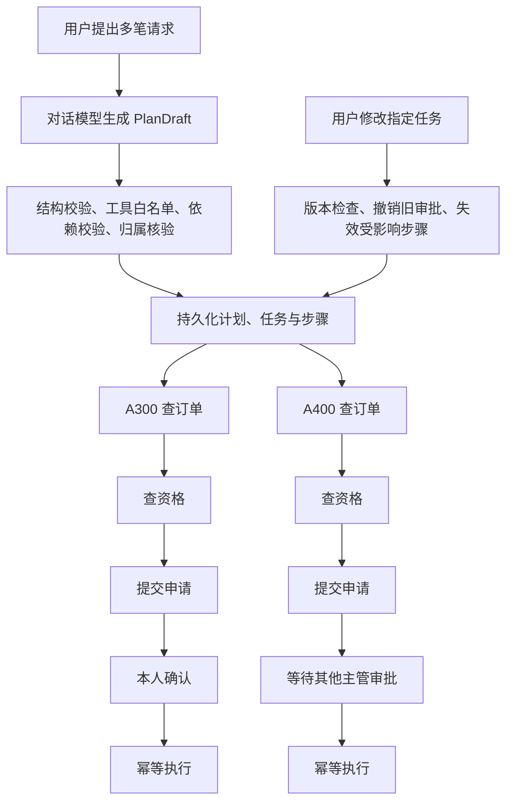

# 多任务规划与编排：实现、演示和验证边界

本轮把“一个聊天会话等于一个退款任务”扩展为“会话下至多两笔独立退款任务”。
模型通过结构化工具提出任务、参数和依赖；服务端校验后保存并调度。
审批与退款仍使用原有的归属检查、风险分级、四眼原则和幂等链路。

## 一个完整例子

以 `acme-user / demo1234` 登录，开启新会话，输入：

> 请同时申请两笔退款：A300 尺码不合适，A400 有质量问题。A400 等主管时先处理 A300。

两笔订单都属于该用户。A300 是低风险本人确认，A400 是大额订单，需要同租户的其他审批人。
不要用 A100 + A400 演示同一客户的双申请：A100 属于 `acme-manager`，归属校验应当拒绝它。

1. 模型调用 `get_refund_plan`，然后通过 `create_refund_plan` 提出计划。
2. 两个订单查询可以并行；资格校验必须依赖对应订单查询。
3. 每笔分别创建审批。页面显示两张独立卡片，可逐笔确认、修改、撤回。
4. 确认 A300 后它可以办结；A400 仍等待主管。期间对话可继续。
5. 输入“只把 A400 的原因改成包装破损，A300 保持不变”。旧 A400 审批作废，
   只重新提交该分支，A300 已完成结果不重做。
6. 由 `acme-manager / demo1234` 在审批队列批准 A400。重新打开会话，可以看到模拟网关生成的退款单号。

演示使用 SQLite 模拟订单/支付网关，不涉及真实付款。

## 模型和调度器各自负责什么



`planning.py` 定义 Pydantic 契约。模型可以决定任务划分、订单/原因/意图和合法依赖，
不能传入任意工具、租户、金额、批准标志或执行动作。
每个退款分支受限为 `lookup_order -> check_policy -> request_refund` 三个业务步骤；
`await_approval` 与 `execute_refund` 由服务器追加。

这是**领域受约束的任务规划**，并不是通用自主规划器。它有真实的结构化模型入口、
可校验计划、持久化执行状态与局部重规划；没有引入多个角色模型互相聊天，也没有声称会自主发现任意工具。
后续改口由模型选择目标任务与新参数，服务器确定性计算需要失效的步骤，不额外调用“反思模型”。

## 文件与职责

| 文件 | 职责 |
|---|---|
| `planning.py` | PlanDraft、任务/步骤契约、无环与前置依赖检查、工具白名单 |
| `plan_store.py` | 计划与分支持久化、事务修改、历史事件、会话映射 |
| `orchestrator.py` | 就绪依赖调度、最多 2 个并行只读步骤、执行抢占、有限重试、恢复 |
| `refund_tasks.py` | 复用原退款版本校验与审批失效事务，支持共享连接 |
| `api.py` | Agent 规划工具、计划 API、逐笔审批匹配、结果回写父会话 |
| `agent_context.py` | 每次调用注入服务端计划摘要，避免仅靠聊天记忆判断状态 |
| `index.html` | 独立审批卡片、计划进度、处理记录、状态刷新 |
| `scripts/recover_plans.py` | 独立于模型的计划恢复入口 |
| `plan_eval.py` | 业务终态评测和可选真实模型对照 |

## 关键工程契约

### 身份与审批

- `(tenant_id, requester_id, conversation_id)` 唯一定位计划，每个分支有独立 `task_id` 和内部任务作用域。
- 客户端只能提交已登录会话内的请求，不能用另一个会话或租户的任务标识修改申请。
- 计划步骤只提出申请。真正批准仍由 `refund_service.decide` 校验操作者。
- ticket 的 payload hash 仍绑定租户、发起人、任务作用域、订单、金额、原因。
- `/chat/resume` 使用服务器查到的分支作用域匹配审批，再将结果写回父会话。
- 同一笔申请批准与修改竞争同一个 SQLite 写事务：修改先成功则旧审批失效，批准先成功则修改拒绝。

### 局部重规划

- 修改原因：保留已成功的查订单/查资格，只失效申请、等待与执行步骤。
- 换订单：清空未重新提供的原因，从订单查询开始失效；新原因缺失时等待用户。
- 缺订单、缺原因、仅咨询：不能生成审批；独立的另一笔可继续。
- 撤回：仅撤销该分支的待审批记录；已批准、执行中或已完成任务不允许撤回。
- 对额外声明的跨分支只读依赖计算传递失效；若会破坏另一笔已提交申请，拒绝修改并提示先处理关联申请。
- `expected_revision` 是任务版本，不是授权令牌。旧版本不能覆盖新状态。

### 会话删除与恢复回执

有待确认、待审批或执行中工单时，删除会话返回 HTTP 409。待审批申请可逐笔撤回，已批准的申请等待执行终态。
检查工单与标记会话关闭共用工单库写事务，已领取但尚未建单的后台步骤也会检查关闭标记。
清理脚本同样跳过仍有活动工单的会话。升级旧数据后先正常启动服务完成数据库迁移，再运行清理脚本。

打开聊天记录时，服务端读取属于该会话和发起人的终态工单，每笔工单展示一条回执。
退款记录与对话 checkpoint 分别持久化，后台恢复和审批请求直接完成的工单通过同一个读接口展示。
旧版已保存到聊天历史的回执按工单 ID 去重。对已打开的页面，重新进入会话即可加载最新回执。

### 抢占、恢复与预算

- `BEGIN IMMEDIATE` 内领取步骤并记录 `run_token`、版本、30 秒租约，随后释放数据库事务。
- 工具执行时不持有调度器写锁。结果只在令牌和步骤版本仍匹配时写回。
- 独立的只读步骤最多并行 2 个；单个 runner 的写步骤串行，跨 runner 由数据库抢占协调。
- 租约到期可重新领取。调度语义是 **at-least-once**；退款副作用通过现有幂等键避免重复。
- “建单成功但步骤结果未保存”和“退款成功但步骤结果未保存”先对账已持久化业务状态，避免盲目重做。
- 每步骤每版本最多 3 次执行尝试，临时故障按 1 秒、2 秒退避；不存在订单、业务拒绝等不盲目重试。
- 每计划最多 40 次业务步骤执行、6 次局部重规划。修改任务不会重置计划总预算。
- 逐轮模型调用预算仍由 `ContextBoundary` 管理；40 次是业务执行预算，**不是跨会话模型 token 预算**。
- API 默认每 2 秒扫描未完成计划；等待审批不会消耗模型调用。可用 `PLAN_WORKER_ENABLED=0` 关闭扫描。
- 单次最多扫描 100 个计划，按持久化的上次扫描时间轮转；大量等待任务不会饿死后面的可运行计划。

```bash
# 一次扫描并恢复可运行任务；不会代替人工批准
python scripts/recover_plans.py --once
# 作为独立恢复 worker 持续扫描
python scripts/recover_plans.py
```

事件包含 request/plan/task/step 标识、步骤版本、工具名、尝试次数、耗时、错误码和工单引用。
步骤完成事件保留对应版本的返回结果，后续重规划清空当前步骤结果时仍能追查原记录。
审批关联到工单的审批者、审批时间与规则版本；不保存模型思维链。

### MCP 与核查器

- MCP 每笔订单独立任务，相同申请幂等；修改带回任务版本。审批交给原 Web 服务。
- MCP 启动会初始化认证、订单和任务表；协议细节见 `docs/mcp.md`。
- 核查器超时或无效结构抛出 `EvidenceUnavailable`，工具返回可有限重试的 `transient`；
  真正缺少业务证据才返回 `no_evidence`。两者都不放行未经核查的回答。
- 核查通过时，服务端核对引用与对应召回片段的原文。找不到匹配原文时按证据不足处理。

## API

这些接口全部要求 Bearer token 和会话归属。

| 接口 | 含义 |
|---|---|
| `GET /sessions/{sid}/plan` | 当前计划、步骤、任务和待审批动作 |
| `POST /sessions/{sid}/plan` | 提议 PlanDraft 并推进可运行步骤 |
| `PATCH /sessions/{sid}/plan/tasks/{task_id}` | 指定任务版本与修改字段，局部重规划 |
| `POST /sessions/{sid}/plan/run` | 幂等推进计划，不绕过审批 |
| `GET /sessions/{sid}/plan/events?after=0` | 按游标查询计划事件 |

原单任务接口保留。已有活动单任务不能被多任务计划悄悄覆盖，须先完成或撤回。
一个会话目前仅一个计划、最多两笔任务；完成后处理新的批次需新会话。

## 如何复现验证

`plan_eval.py` 默认走模拟订单和 SQLite，使用预设任务输入。安装轻量依赖后就可以运行双订单演示，
无需模型 API Key、Redis 或向量索引：

```bash
python -m pip install "fastapi==0.147.0" "pydantic==2.13.5" "python-dotenv==1.2.3"
python plan_eval.py --cases dual --output work/planning/demo.json
```

演示验证两笔独立待审批、客户不能自批 A400、A300 可先办结、最终两笔各退款一次。
打开 `demo.json` 查看 `tickets`、`executions` 和 `plan_events`。全部使用临时数据库。

```bash
python -m pytest tests/test_planning.py tests/test_plan_http.py tests/test_mcp_tools.py tests/test_evidence_verdict.py -q
python plan_eval.py --repeat 3 --output work/planning/system.json
python scripts/compare_replanning.py --repeat 10 --output work/planning/replanning.json
python scripts/verify_project.py --output work/planning/verification

# 真实模型试跑：产生 API 费用，每场景每方案最多 16 次模型调用
python plan_eval.py --with-model --variant both --cases dual --output work/planning/model-pilot.json
```

确定性测试使用真实 SQLite、订单/退款服务；HTTP 集成测试使用真实 FastAPI、LangGraph 和 checkpoint，
只将语言模型替换为脚本响应。它们证明状态、权限和恢复契约，不等于自然语言规划成功率。

真实模型的 `both` 对照使用同一模型、双任务存储、调度、订单和审批服务。
固定图方案由模型提取任务参数，服务器生成步骤。模型规划方案还会让模型提供步骤和依赖。
两组的工具契约和提示随方案调整，双方都排除 RAG。延迟不含人工审批等待。
可去掉 `--cases dual` 跑全部 7 个合成场景。旧的单任务 ReAct 对照仍可通过 `--variant legacy` 复现。

局部重规划对照固定同一个已完成分支，分别对另一分支改原因、换订单、撤回。全量基线在允许复用的场景关闭该分支的查询结果复用。
指标是重规划后实际执行的业务步骤次数。撤回通过同一业务事务撤销原审批，因此两组都无需执行新的调度步骤。

本轮测试结果和未完成项见 `docs/planning-verification-2026-11-10.md`。

## 简历与面试的准确表述

可以写：

> 在售后 Agent 中实现结构化任务规划与持久化 DAG 编排，支持多订单分支执行、审批等待、
> 基于版本的局部重规划和租约恢复；通过事务校验与退款幂等保证改口、并发和崩溃场景下的业务一致性。

面试时重点讲清：模型能决定什么、服务端拒绝什么、为何不能靠消息历史保存任务、
at-least-once 如何配合幂等、修改与审批谁先成功、为什么只重跑受影响步骤。

暂不写“通用多 Agent 平台”“分布式高并发”“生产级支付系统”“成功率提升 xx%”。
当前仍是单机 SQLite、受约束退款领域、模拟支付网关和小样本开发集验证。
